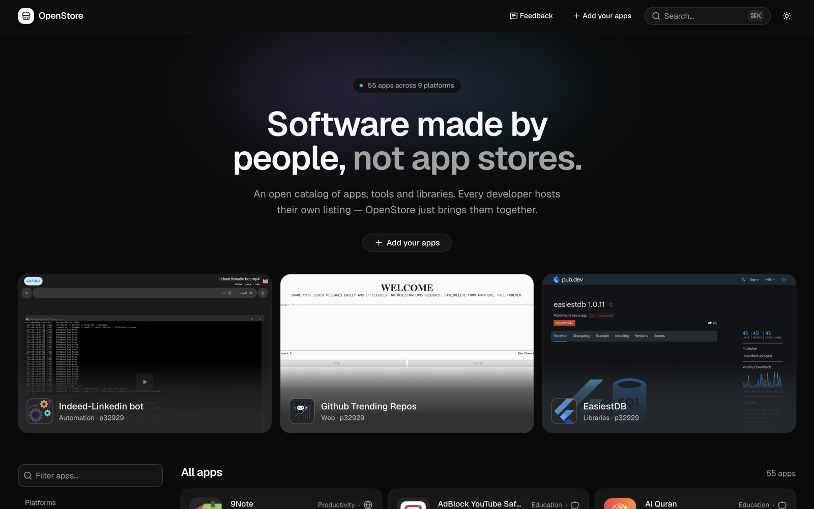
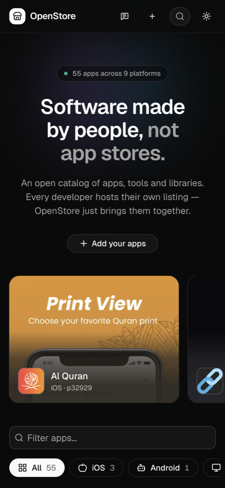

<h1 align="center">OpenStore</h1>
<p align="center"><b>Software made by people, not app stores.</b><br>
An open catalog of apps, tools and libraries. Every developer keeps their listing in their own GitHub repo.</p>
<p align="center"><a href="https://openstore.pfay.workers.dev"><b>Open the store →</b></a> &nbsp;·&nbsp; <a href="https://openstore.pfay.workers.dev/add"><b>Add your apps</b></a> &nbsp;·&nbsp; <a href="https://openstore.pfay.workers.dev/why">Why OpenStore</a></p>

<p align="center">
  <a href="https://openstore.pfay.workers.dev"></a>
  <a href="https://openstore.pfay.workers.dev"></a>
</p>

## Why you might want this

Good apps keep disappearing. Stores change their rules, remove old apps, and can close a developer account without a warning.

OpenStore is a different deal:

1. **Free.** No fees. No testers to find. No waiting for approval when you update an app.
2. **Yours.** Your listing is a few text files in your own public GitHub repo. Nobody can take it away.
3. **Everything in one place.** Web, Android, iOS, desktop, libraries, bots. Link to wherever your app already lives.

## How it works

1. **Copy the template.** Get the [`template` branch](https://github.com/p32929/p32929_openstore/tree/template) into a new public repo.
2. **Add one file per app.** A short `.md` file in `apps/`: name, icon, screenshots, links.
3. **Check it.** Run `node validate.mjs`. It tells you the exact line to fix.
4. **Join once.** Open one pull request on [openstore_maintainers](https://github.com/p32929/openstore_maintainers).

After that, every push to your repo shows up on OpenStore within a day.

An app file looks like this:

```yaml
---
title: My App
icon: images/icon.png
screenshots: [images/screenshot.png]
category: Productivity
platforms:
  Web: https://my-app.example.com
---

What it does, in plain Markdown.
```

## This repo

This is my own listing: the real one, with my apps, as a working example. Every `.md` file in [`apps/`](apps/) is an app, and its file name becomes its link. [`profile.yaml`](profile.yaml) is my developer page.

Want the same for yourself? Start from the [`template` branch](https://github.com/p32929/p32929_openstore/tree/template), not from this one.

Before pushing changes here:

```bash
node validate.mjs
```

## Links

- [OpenStore](https://openstore.pfay.workers.dev) · [My listing](https://openstore.pfay.workers.dev/dev/p32929)
- [Join the list](https://github.com/p32929/openstore_maintainers) · [Bugs, ideas and questions](https://github.com/p32929/openstore_feedback)
